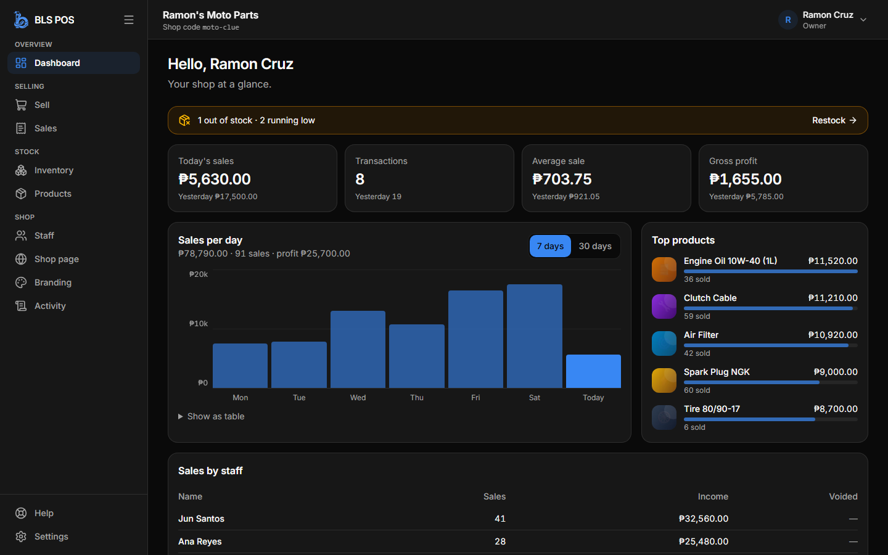
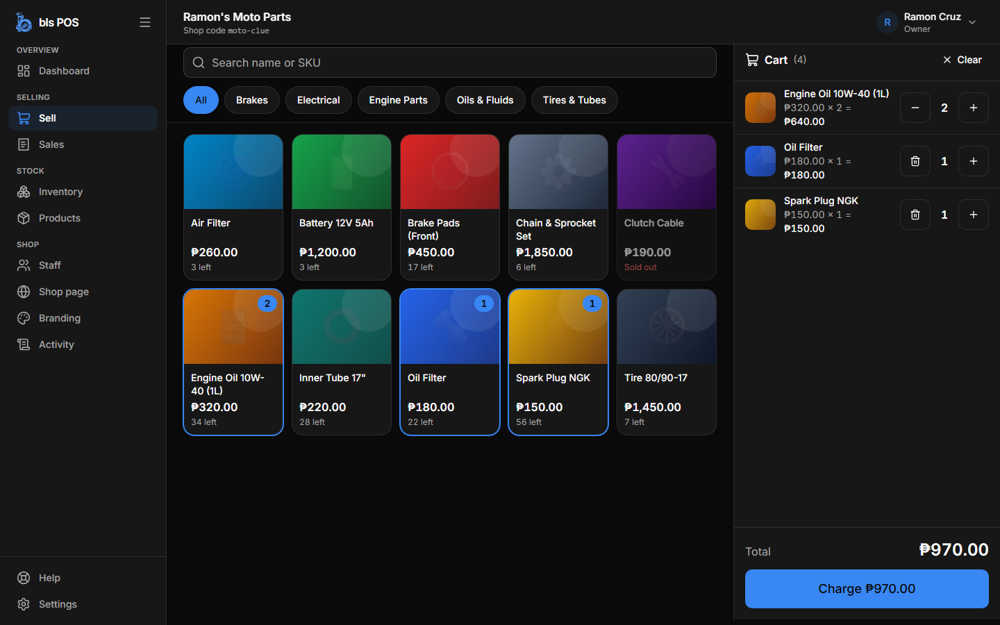
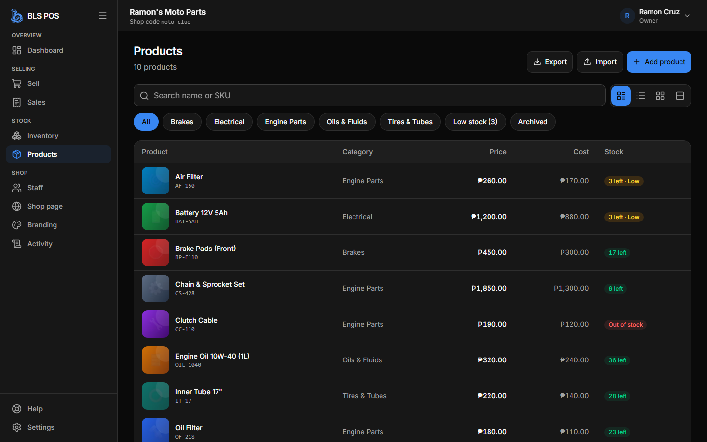
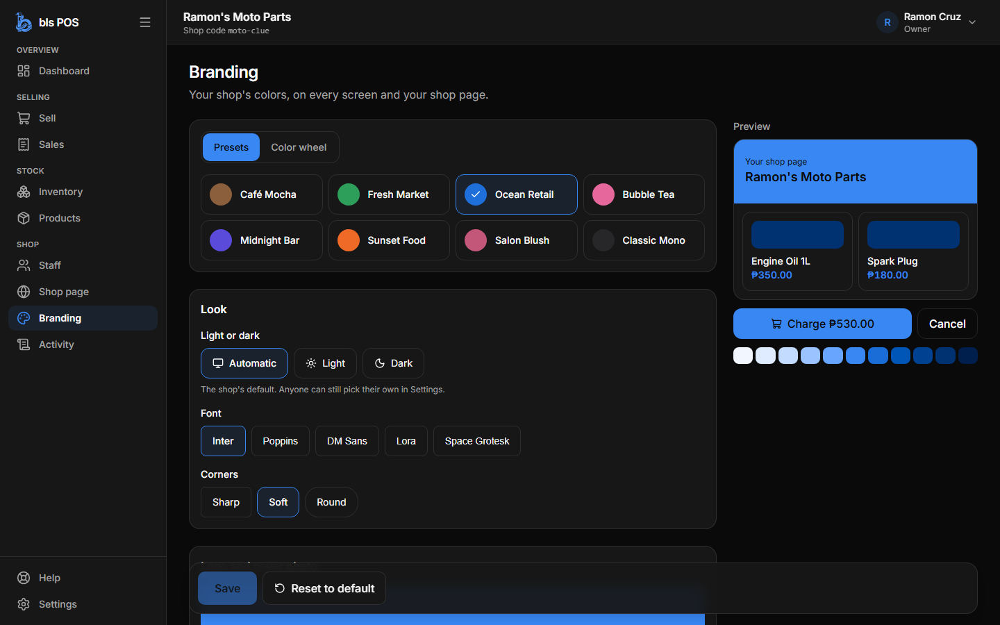
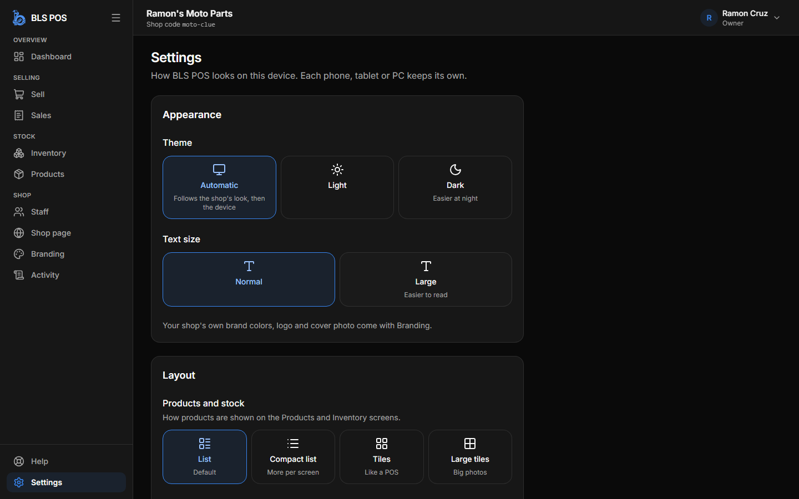
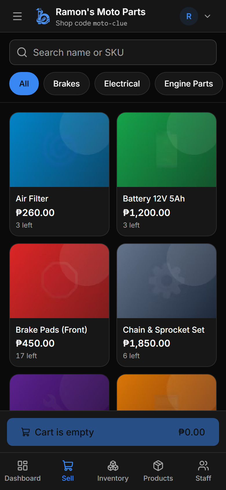
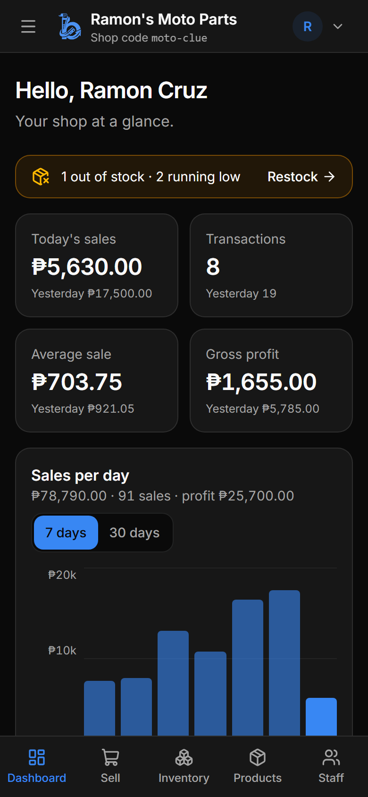

<h1 align="center">
  <picture>
    <source media="(prefers-color-scheme: dark)" srcset="docs/assets/logo-dark.png" />
    
  </picture>
  bls POS
</h1>

<p align="center">
  <a href="https://github.com/og-cz/bls-pos"></a>
  <a href="https://github.com/og-cz/bls-pos/actions/workflows/ci.yml"></a>
  
  
  
  
</p>

<p align="center">
  <strong>Instant point-of-sale and inventory for any small business.</strong><br/>
  Sign up, brand your shop, add products and staff, and start selling from a phone or PC — free.
</p>

> **Status:** v1.0.0-rc.1, live and in pilot with the first shops. Screenshots show a demo
> shop with sample data.

<p align="center">
  
</p>

## System Features

<table>
<tr>
<td width="50%" valign="middle">

### Fast Checkout

Tap products into the cart, search by name or SKU, or scan a barcode, then **Charge**. For
cash, enter what the customer gave and the change is worked out. Prices always come from
the server, and stock can never go below zero.

[Full size →](docs/assets/screenshots/sell.png)

</td>
<td width="50%">
  <a href="docs/assets/screenshots/sell.png"></a>
</td>
</tr>
<tr>
<td width="50%" valign="middle">

### Products and Stock

Price, cost, category, SKU and a photo for every product. Admins restock; staff deduct
stock with a reason (damaged, expired, used, lost). Every change is logged with who, when,
how many and why, and low stock is flagged.

[Full size →](docs/assets/screenshots/products.png)

</td>
<td width="50%">
  <a href="docs/assets/screenshots/products.png"></a>
</td>
</tr>
<tr>
<td width="50%" valign="middle">

### Live Dashboard

Today's sales, transactions, average sale and gross profit against yesterday; sales per
day for 7 or 30 days; top products; sales by staff; and what is running low. Staff see only
their own sales for today.

[Full size →](docs/assets/screenshots/dashboard.png)

</td>
<td width="50%">
  <a href="docs/assets/screenshots/dashboard.png"></a>
</td>
</tr>
<tr>
<td width="50%" valign="middle">

### Shop Branding

Each shop looks like its own brand: a preset or any color, light or dark mode, font,
corner style, logo and cover photo, with a live preview. Colors are checked so text always
stays readable.

[Full size →](docs/assets/screenshots/branding.png)

</td>
<td width="50%">
  <a href="docs/assets/screenshots/branding.png"></a>
</td>
</tr>
<tr>
<td width="50%" valign="middle">

### Settings per Device

Each phone, tablet or PC keeps its own theme, text size, product layout (list, compact
list or tiles) and menu side. Each person's profile covers their password, two-step login
and signing out other devices.

[Full size →](docs/assets/screenshots/settings.png)

</td>
<td width="50%">
  <a href="docs/assets/screenshots/settings.png"></a>
</td>
</tr>
<tr>
<td width="50%" valign="middle">

### Works on Any Phone

The same app from phone to desktop. On phones the main screens sit in a bottom tab bar and
the full menu slides in from the side. Install it like an app: Android, Chrome → Install
app; iPhone, Safari → Share → Add to Home Screen.

[Full size →](docs/assets/screenshots/phone-sell.png)

</td>
<td width="50%">
  <a href="docs/assets/screenshots/phone-sell.png"></a>
  <a href="docs/assets/screenshots/phone-dashboard.png"></a>
</td>
</tr>
</table>

**Also in the box:**

- **Offline selling** — Sales are saved on the device without internet and sync when it's back, never twice.
- **Owner, admin and staff roles** — Every rule is checked on the server, not just hidden on screen.
- **Public shop page** — An optional page with your products and a QR code to share.
- **Receipts, voids and CSV export** — Print a receipt; void a sale with a reason; export sales and products.
- **Small photos** — Saved as AVIF on the device, so a phone photo of a few MB becomes about 30–90 KB.
- **Recovery codes and two-step login** — Get back in without email; protect owner and admin accounts.
- **Guided setup and help** — A setup wizard, short tours for owners and staff, and an in-app help center.

---

## Who can do what

| Role      | Can do                                                                                   |
| --------- | ---------------------------------------------------------------------------------------- |
| **Owner** | Everything below, plus delete the shop, manage admins and keep the recovery codes        |
| **Admin** | Products, prices, restock, staff, void sales, all reports, branding                      |
| **Staff** | Sell, deduct stock with a reason, view products and stock, see their own sales for today |

Every rule is checked on the server, not just hidden in the screen.

## Your data is safe

- **Sales are never deleted.** A mistake is _voided_ (with a reason and who did it), so
  the history stays complete. Closed days are locked in the database itself.
- **Updates never erase data.** Database changes only ever add tables and columns.
- **Backups:** every shop is backed up nightly (kept 14 days), on top of the database's
  own 7-day point-in-time restore.
- **Only the owner can delete a shop,** by typing the shop code and their password. It is
  hidden at once and only erased for good after 30 days.
- Passwords are salted and hashed, logins are rate-limited with bot protection, and an
  audit log records every sensitive action.

## Stack

Cloudflare Workers (API + static assets), D1 (data, photos and backups), Turnstile ·
Hono · Drizzle · Zod · React + Vite + TypeScript · Tailwind CSS + shadcn/ui · TanStack
Query.

Everything runs on free tiers that allow commercial use and never sleep — no card needed.

## Development

Requirements: Node.js 22+ and pnpm 10+.

```bash
pnpm install
pnpm dev
```

## Self-hosting

Runs free on Cloudflare (Workers and D1). Step-by-step: [docs/DEPLOY_FREE.md](docs/DEPLOY_FREE.md).

## License

bls POS is free and open source under the [MIT License](LICENSE).
